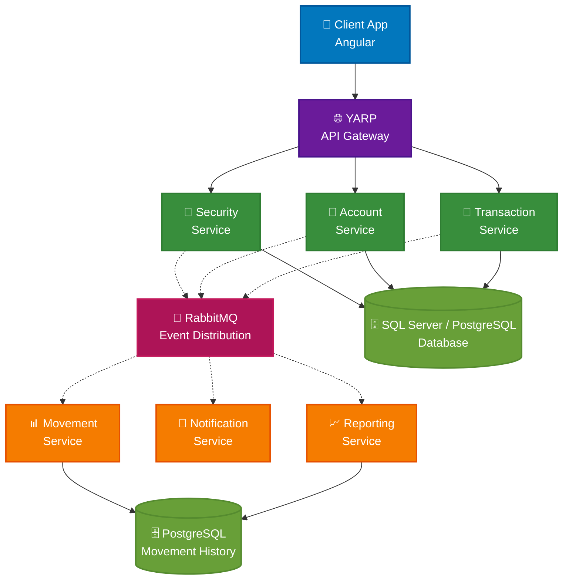

# Bank System Microservices

<!-- Sonar Qube Badges -->
<table>
  <tr>
    <td><a href="https://sonarcloud.io/summary/new_code?id=cristofima_BankSystemMicroservices"></a></td>
    <td><a href="https://sonarcloud.io/summary/new_code?id=cristofima_BankSystemMicroservices"></a></td>
    <td><a href="https://sonarcloud.io/summary/new_code?id=cristofima_BankSystemMicroservices"></a></td>
    <td><a href="https://sonarcloud.io/summary/new_code?id=cristofima_BankSystemMicroservices"></a></td>
    <td><a href="https://sonarcloud.io/summary/new_code?id=cristofima_BankSystemMicroservices"></a></td>
  </tr>
  <tr>
    <td><a href="https://sonarcloud.io/summary/new_code?id=cristofima_BankSystemMicroservices"></a></td>
    <td><a href="https://sonarcloud.io/summary/new_code?id=cristofima_BankSystemMicroservices"></a></td>
    <td><a href="https://sonarcloud.io/summary/new_code?id=cristofima_BankSystemMicroservices"></a></td>
    <td><a href="https://sonarcloud.io/summary/new_code?id=cristofima_BankSystemMicroservices"></a></td>
    <td><a href="https://sonarcloud.io/summary/new_code?id=cristofima_BankSystemMicroservices"></a></td>
    <td><a href="https://sonarcloud.io/summary/new_code?id=cristofima_BankSystemMicroservices"></a></td>
  </tr>
</table>

A modern, cloud-native banking system built with .NET 9 microservices architecture, designed for local Docker-based development with Clean Architecture, CQRS, and Event-Driven Architecture patterns.

## 🏗️ Architecture Overview

This system implements a distributed banking platform using microservices that communicate through RabbitMQ events, following Domain-Driven Design (DDD) principles and the CQRS pattern for optimal scalability and maintainability.

### Core Microservices

- **🔐 Security Service**: Handles authentication, authorization, and user management
- **🏦 Account Service**: Manages customer accounts, balances, and account operations
- **💸 Transaction Service**: Processes financial transactions (deposits, withdrawals) - Write operations
- **📊 Movement Service**: Provides transaction history and reporting - Read operations
- **🔔 Notification Service**: Manages multi-channel notifications and alerts
- **📈 Reporting Service**: Handles analytics, reports, and business intelligence

### Architecture Patterns

- **Clean Architecture**: Clear separation of concerns across layers
- **CQRS (Command Query Responsibility Segregation)**: Separate read and write operations
- **Event-Driven Architecture**: Asynchronous communication via RabbitMQ
- **Domain-Driven Design**: Rich domain models with business logic encapsulation
- **Microservices**: Independently deployable and scalable services

## 🚀 Technology Stack

### Backend

- **.NET 9**: Latest framework with improved performance and features
- **ASP.NET Core**: Web API framework
- **Entity Framework Core**: ORM for data access
- **MediatR**: CQRS and Mediator pattern implementation
- **FluentValidation**: Input validation
- **AutoMapper**: Object-to-object mapping
- **Serilog**: Structured logging

### Local Infrastructure

- **RabbitMQ**: Message broker for event-driven communication
- **SQL Server / PostgreSQL**: Local relational databases
- **PostgreSQL**: Local relational storage for movement history and reporting
- **Environment variables**: Local secrets and configuration management
- **.NET Aspire Dashboard + OpenTelemetry**: Local monitoring and telemetry
- **YARP API Gateway**: Local API routing and management
- **Docker Compose**: Local infrastructure containers

### Development Tools

- **Docker**: Containerization
- **.NET Aspire**: Local development orchestration and monitoring _(Local Development Only)_
- **YARP**: Reverse proxy for API Gateway _(Local Development Only)_
<!-- Azure deployment and Azure DevOps CI are intentionally disabled while working locally. -->
<!-- - **Terraform/Bicep**: Infrastructure as Code -->
<!-- - **Azure DevOps**: CI/CD pipelines -->
- **xUnit**: Unit testing framework
- **FluentAssertions**: Assertion library

### Environment Architecture

#### Local Development Environment

- **API Gateway**: YARP-based reverse proxy for service routing
- **.NET Aspire Dashboard**: Local orchestration and monitoring
- **ServiceDefaults**: Aspire-based service configuration and telemetry

#### Local Environment

- **YARP API Gateway**: Local API routing, policies, and security
- **.NET Aspire Dashboard**: Local orchestration and monitoring
- **.NET Aspire Service Discovery**: Local service discovery and resilience

## 🏛️ System Architecture



## 🔄 Event-Driven Flow

### Transaction Processing Flow

1. **Client** submits a deposit, withdrawal, or transfer request through the Transaction API
2. **Transaction Service** stores the operation as `Pending` and publishes `TransactionCompletedIntegrationEvent`
3. **Account Service** validates the request, applies the balance changes, and records a durable receipt
4. **Account Service** publishes an `Applied` or `Rejected` result through its configured outbox
5. **Transaction Service** changes the operation to `Completed` or `Failed` after receiving that result

The initial `Pending` state is not proof that funds were applied. The financial workflow and its infrastructure still require environment-specific validation before production use.

### Benefits

- **Loose Coupling**: Services communicate through events
- **Scalability**: Each service can scale independently
- **Resilience**: Failure in one service doesn't affect others
- **Eventual Consistency**: Data consistency across services

## 📁 Project Structure

```text
BankSystemMicroservices-local/
├── BankSystem.sln
├── Common/
│   ├── ServiceDefaults/
│   ├── src/
│   │   ├── BankSystem.Shared.Application/
│   │   ├── BankSystem.Shared.Auditing/
│   │   ├── BankSystem.Shared.Domain/
│   │   ├── BankSystem.Shared.Infrastructure/
│   │   ├── BankSystem.Shared.Kernel/
│   │   └── BankSystem.Shared.WebApiDefaults/
│   └── tests/
├── Services/
│   ├── Security/
│   ├── Account/
│   ├── Transaction/
│   ├── Movement/
│   ├── Notification/
│   └── Reporting/
├── Gateway/
│   └── ApiGateway/
├── AppHost/
│   └── BankSystem.AppHost.csproj
├── docker-compose/
│   ├── docker-compose.dcproj
│   ├── docker-compose.yml
│   └── postgres/init/01-create-databases.sql
├── docs/
├── scripts/
└── build/
```

Each runnable API contains its own `Dockerfile` inside the API project. The `docker-compose` project at the solution root orchestrates the complete local stack.

### Local Components

- **AppHost/**: .NET Aspire orchestration and local dashboard
- **Gateway/**: YARP API Gateway
- **Services/**: six business microservices
- **docker-compose/**: Visual Studio Docker Compose project for the complete local stack
- **RabbitMQ + MassTransit**: local event transport

## 🚦 Getting Started

### Prerequisites

- .NET 9 SDK
- Docker Desktop
- Visual Studio 2022 or VS Code

### Local Development Setup

1. **Start local infrastructure**
   ```bash
   docker compose -f docker-compose/docker-compose.yml up -d --build
   ```

2. **Open the solution**
   Open `BankSystem.sln` in Visual Studio 2022.

3. **Run .NET Aspire**
   Start `BankSystem.AppHost`. Aspire orchestrates and monitors the six APIs and the local YARP gateway.

4. **Check RabbitMQ**
   Open `http://localhost:15672` with `bankuser / bankpassword`.

5. **Stop local infrastructure**
   ```bash
   docker compose -f docker-compose/docker-compose.yml down
   ```

> Azure deployment is intentionally inactive. Local development uses Docker Compose and .NET Aspire only.

## 🔧 Configuration

### Environment Variables

```bash
# Database Connections
CONNECTIONSTRINGS__DEFAULTCONNECTION="Server=localhost;Database=BankSystem;Trusted_Connection=true;"

# RabbitMQ
MASSTRANSIT__RABBITMQ__HOST="rabbitmq://localhost:5672"

# JWT Settings
JWT__KEY="your-super-secret-key"
JWT__ISSUER="https://localhost:5001"
JWT__AUDIENCE="bank-system-api"
```

## 📊 API Documentation

Each microservice exposes its own OpenAPI/Scalar documentation:

- **Security API**: `https://localhost:5001/scalar`
- **Account API**: `https://localhost:5002/scalar`
- **Transaction API**: `https://localhost:5003/scalar`
- **Movement API**: `https://localhost:5004/scalar`
- **Notification API**: `https://localhost:5005/scalar`
- **Reporting API**: `https://localhost:5006/scalar`

## 🧪 Testing

### Run Unit Tests

**Basic unit test execution:**

```bash
dotnet test
```

**Run unit tests with code coverage (recommended):**

```powershell
# Use the provided PowerShell script
./scripts/run-unit-tests.ps1
```

This will:

- Run all unit test projects in the solution
- Generate code coverage reports in multiple formats (HTML, Cobertura, JSON)
- Open the HTML coverage report automatically
- Results are saved to `TestResults/` directory

**Manual coverage command:**

```bash
dotnet test --configuration Debug --collect:"XPlat Code Coverage" --settings coverlet.runsettings --results-directory TestResults /p:CollectCoverage=true /p:CoverletOutputFormat=cobertura /p:CoverletOutput=TestResults/coverage.cobertura.xml
```

### Run Integration Tests

```bash
dotnet test --configuration Release --filter Category=Integration
```

### Load Testing

No load-test scenario is currently included at `tests/load/transaction-load-test.js`; the command from the previous README was stale.

### Available Test Scripts

See [scripts/README.md](scripts/README.md) for detailed information about available build and test scripts.

## 🚀 Deployment

The current version is focused on local development. The application services are started through .NET Aspire and the infrastructure through Docker Compose.

For a later production deployment, the infrastructure provider can be changed without coupling the domain/application layers to a cloud vendor.

## 🔍 Monitoring & Observability

- **.NET Aspire Dashboard**: Local service status, logs and telemetry
- **OpenTelemetry**: Metrics and distributed tracing
- **Structured Logging**: Serilog
- **Health Checks**: Service readiness and liveness

## 🤝 Contributing

1. Fork the repository
2. Create a feature branch (`git checkout -b feature/amazing-feature`)
3. Follow the [Development Guidelines](docs/dotnet-development-guidelines.md)
4. Commit your changes (`git commit -m 'Add amazing feature'`)
5. Push to the branch (`git push origin feature/amazing-feature`)
6. Open a Pull Request

## 📚 Documentation

- [.NET Development Guidelines](docs/dotnet-development-guidelines.md)
- [API Documentation](docs/api-documentation.md)
- [Architecture Decision Records](docs/adr/)
- [Deployment Guide](docs/deployment-guide.md)

## 📄 License

This project is licensed under the MIT License - see the [LICENSE](LICENSE) file for details.

## 🔗 Related Services

- [Security Service](Services/Security/README.md)
- [Account Service](Services/Account/README.md)
- [Transaction Service](Services/Transaction/README.md)
- [Movement Service](Services/Movement/README.md)
- [Notification Service](Services/Notification/README.md)
- [Reporting Service](Services/Reporting/README.md)

## 🐳 Local Docker stack

The repository contains one Visual Studio Docker Compose project at `docker-compose/`.
It builds the seven application containers and starts PostgreSQL, SQL Server and RabbitMQ.

```powershell
docker compose -f docker-compose/docker-compose.yml up -d --build
```

Main entry point: `http://localhost:55837`
RabbitMQ Management: `http://localhost:15672` (use the credentials configured in the local environment; see `.env.example`).

To reset the local databases and containers:

```powershell
docker compose -f docker-compose/docker-compose.yml down -v
docker compose -f docker-compose/docker-compose.yml up -d --build
```

For Visual Studio + .NET Aspire, open `BankSystem.sln` and start `BankSystem.AppHost` after the Docker infrastructure is running.

See `docker-compose/README.md` for the Docker layout and commands.
