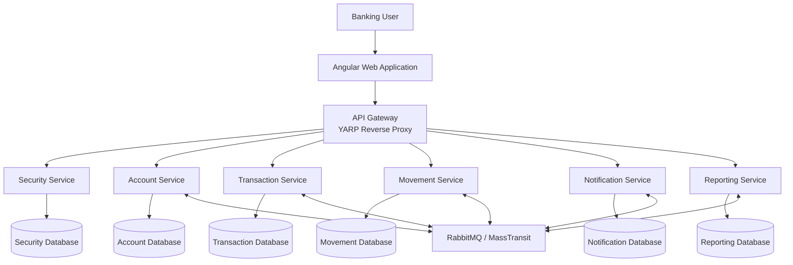
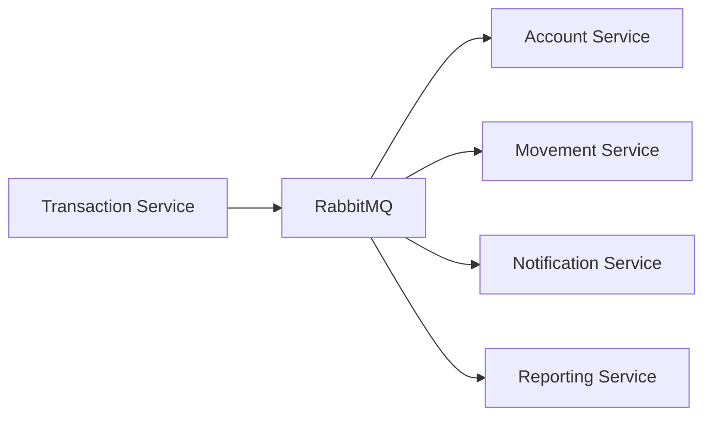

# 🏦 BankSystem — Banking Microservices Platform

### Full-Stack Banking Application | ASP.NET Core · Angular · Microservices · RabbitMQ · PostgreSQL

BankSystem is a full-stack banking application built around a **microservices architecture**, with a **.NET backend** and an **Angular frontend**.

The project demonstrates how to design a modular banking platform using **Domain-Driven Design (DDD)**, **Clean Architecture**, **CQRS**, event-driven communication, API security, and containerized infrastructure.

The application is organized into independent services responsible for banking operations such as authentication, account management, transactions, movements, notifications, and reporting.

> **Project scope:** This repository contains the .NET banking microservices and Angular web application. Fraud detection is not included in this repository.

---

## 📑 Table of Contents

1. [Project Overview](#-project-overview)
2. [Technology Stack](#-technology-stack)
3. [System Architecture](#-system-architecture)
4. [Microservices](#-microservices)
5. [Frontend Architecture](#-frontend-architecture)
6. [Backend Architecture](#-backend-architecture)
7. [Communication Between Services](#-communication-between-services)
8. [Security Architecture](#-security-architecture)
9. [Database Architecture](#-database-architecture)
10. [Project Structure](#-project-structure)
11. [Getting Started](#-getting-started)
12. [Testing and Quality](#-testing-and-quality)
13. [Engineering Concepts](#-engineering-concepts)
14. [Future Improvements](#-future-improvements)
15. [License and Attribution](#-license-and-attribution)

---

## 🎯 Project Overview

BankSystem aims to model a modern banking application using a distributed architecture.

Rather than implementing all features in a single monolithic application, the system separates responsibilities into dedicated microservices.

### Main Objectives

- Build a modular and maintainable banking platform.
- Separate business responsibilities into independent services.
- Apply Clean Architecture and Domain-Driven Design principles.
- Use asynchronous messaging for communication between services.
- Secure banking APIs through authentication and authorization.
- Provide a modern web interface with Angular.
- Support local development using Docker Compose.
- Demonstrate backend, frontend, and distributed-systems engineering skills.

### Core Banking Capabilities

The project includes components for:

- User registration and authentication.
- Bank account management.
- Account activation, suspension, freezing, and closure.
- Banking transactions.
- Payment and transfer workflows.
- Account movements and transaction history.
- User notifications.
- Financial reporting and summaries.
- API routing and centralized gateway access.

Some workflows may require additional configuration or infrastructure before they can be exercised end to end.

---

## 🛠️ Technology Stack

| Layer | Technologies |
|---|---|
| Frontend | Angular, TypeScript, HTML, SCSS |
| Backend | C#, ASP.NET Core, .NET |
| Architecture | Microservices, Clean Architecture, DDD, CQRS |
| API Gateway | YARP Reverse Proxy |
| Messaging | RabbitMQ, MassTransit |
| Database | PostgreSQL |
| Data Access | Entity Framework Core |
| Authentication | JWT-based authentication |
| Inter-service Communication | REST APIs, asynchronous events, gRPC components |
| Containerization | Docker, Docker Compose |
| Development Tools | Visual Studio Code, .NET CLI, Angular CLI |
| Testing | xUnit-based unit and integration test projects |
| CI Configuration | Azure Pipelines |

---

## 🏗️ System Architecture

BankSystem follows a distributed architecture in which the Angular frontend communicates with backend APIs through an API Gateway.

Each microservice owns a specific business responsibility.



### Architectural Principles

**1. Separation of concerns**

Each microservice handles a clearly defined business domain.

**2. Independent service boundaries**

Services have their own application logic, domain models, and infrastructure components.

**3. Event-driven communication**

RabbitMQ and MassTransit support asynchronous communication between services.

**4. API Gateway pattern**

The gateway provides a common entry point for frontend requests and applies routing and security-related configuration.

**5. Database separation**

The architecture separates persistence responsibilities by service, reducing direct coupling between business domains.

**6. Maintainability and extensibility**

New services and features can be introduced without placing all business logic into a single application.

---

## 🧩 Microservices

### 🔐 1. Security Service

**Responsibility:** Authentication, identity, and access control.

Main components include:

- User registration.
- User login and logout.
- JWT token generation.
- Refresh token management.
- Token revocation.
- Password validation.
- User identity persistence.
- Authentication-related auditing.

**Location:**

`Services/Security/`

The service is divided into API, Application, Domain, and Infrastructure projects.

### 💳 2. Account Service

**Responsibility:** Bank account lifecycle and account-related business rules.

Main capabilities include:

- Account creation.
- Account retrieval.
- Account activation.
- Account freezing and suspension.
- Account closure.
- Account transfer authorization.
- Account state management.
- Integration with transaction events.

**Location:**

`Services/Account/`

### 💸 3. Transaction Service

**Responsibility:** Banking transaction processing.

Main components include:

- Transaction creation.
- Transaction retrieval.
- Transaction status tracking.
- Payment transfer event consumption.
- Transaction-related event publishing.
- Financial result handling.
- Messaging correlation.
- Outbox-based message processing components.

**Location:**

`Services/Transaction/`

The transaction service is an important part of the system's event-driven architecture.

### 📒 4. Movement Service

**Responsibility:** Recording and retrieving account movements.

Main components include:

- Account movement entities.
- Movement queries.
- Transaction event consumers.
- Financially completed transaction event handling.
- Movement persistence.

**Location:**

`Services/Movement/`

### 🔔 5. Notification Service

**Responsibility:** Managing banking notifications.

Main components include:

- Notification creation.
- Notification retrieval.
- User notification preferences.
- Transaction-related event consumption.
- Notification delivery abstractions.
- Logging-based notification sender implementation.

**Location:**

`Services/Notification/`

### 📊 6. Reporting Service

**Responsibility:** Banking reports and financial summaries.

Main components include:

- Report generation commands.
- Report execution tracking.
- Report summaries.
- Transaction analytics entities.
- Event consumers.
- Report persistence.

**Location:**

`Services/Reporting/`

---

## 🖥️ Frontend Architecture

The frontend is developed using **Angular** and organized by business feature.

**Location:**

`Frontend/BankSystem.Web/`

### Main Frontend Modules

| Feature | Purpose |
|---|---|
| Authentication | Login and registration |
| Dashboard | Overview of banking information |
| Accounts | Account creation and account management |
| Transactions | Transfers, deposits, withdrawals, and payment history |
| Movements | Account movement history |
| Notifications | Banking notifications |
| Reports | Financial reporting interface |

### Angular Application Structure

```text
Frontend/
└── BankSystem.Web/
    ├── src/
    │   ├── app/
    │   │   ├── features/
    │   │   │   ├── accounts/
    │   │   │   ├── authentication/
    │   │   │   ├── dashboard/
    │   │   │   ├── movements/
    │   │   │   ├── notifications/
    │   │   │   ├── reports/
    │   │   │   └── transactions/
    │   │   ├── layout/
    │   │   │   ├── footer/
    │   │   │   ├── navbar/
    │   │   │   └── sidebar/
    │   │   └── shared/
    │   ├── assets/
    │   ├── environments/
    │   ├── index.html
    │   ├── main.ts
    │   └── styles.scss
    └── tsconfig.json
```

### Frontend Design Principles

- Feature-based organization.
- Separation between pages, components, models, and services.
- Reusable layout components.
- Shared application utilities.
- Dedicated API service abstractions.
- TypeScript models for business data.

---

## 🧱 Backend Architecture

The backend services use a layered organization inspired by **Clean Architecture** and **Domain-Driven Design**.

A typical microservice follows this structure:

```text
Service/
├── src/
│   ├── Service.Api/
│   │   ├── Controllers/
│   │   ├── Program.cs
│   │   └── DependencyInjection.cs
│   │
│   ├── Service.Application/
│   │   ├── Commands/
│   │   ├── Queries/
│   │   ├── Handlers/
│   │   ├── DTOs/
│   │   ├── Interfaces/
│   │   └── Validators/
│   │
│   ├── Service.Domain/
│   │   ├── Entities/
│   │   ├── Enums/
│   │   └── ValueObjects/
│   │
│   └── Service.Infrastructure/
│       ├── Data/
│       ├── Repositories/
│       ├── Consumers/
│       ├── Messaging/
│       └── Migrations/
│
└── tests/
    ├── Application.UnitTests/
    ├── Domain.UnitTests/
    └── Infrastructure.IntegrationTests/
```

*The exact structure varies by microservice.*

### API Layer

Handles HTTP requests, API endpoints, middleware, and application configuration.

### Application Layer

Coordinates business use cases through commands, queries, handlers, interfaces, and validation.

### Domain Layer

Contains business entities, domain concepts, and rules.

### Infrastructure Layer

Implements persistence, repositories, external communication, and message consumers.

---

## 🔄 Communication Between Services

BankSystem combines synchronous API communication with asynchronous event-driven processing.

### Synchronous Communication

The Angular application sends HTTP requests through the API Gateway.

```text
Angular Frontend
       |
       v
    API Gateway
       |
       v
  Target Microservice
       |
       v
     Response
```

### Asynchronous Communication

RabbitMQ and MassTransit enable services to react to business events.

For example, a transaction-related event may be consumed by another service to update account-related data, record movements, or trigger notifications.



### Reliability Patterns

The codebase includes components related to:

- Transaction event consumers.
- Outbox message persistence.
- Background message relays.
- Event correlation.
- Handling financial transaction results.

These patterns help organize distributed workflows and reduce coupling between services.

---

## 🔒 Security Architecture

Security is a central concern for a banking application.

The project includes security-related components such as:

- JWT authentication.
- Refresh token handling.
- Token revocation.
- Custom password validation.
- API Gateway authentication policies.
- Authorization-related application logic.
- Security auditing.
- HTTP security header configuration.

### Security Considerations

The repository uses configuration files and environment variable templates to support local development.

**Important:** Never commit real passwords, production API keys, private certificates, or other sensitive credentials.

The project is intended for development and demonstration. It should not be treated as production-ready banking software without a complete security review, operational hardening, and end-to-end validation.

---

## 🗄️ Database Architecture

The system uses **PostgreSQL** with persistence components organized around microservice responsibilities.

Database access is implemented through **Entity Framework Core** in the relevant services.

### Main Persistence Responsibilities

| Service | Data |
|---|---|
| Security | Users, refresh tokens, identity-related records |
| Account | Accounts, account status, transfer authorizations |
| Transaction | Transactions, payment-related records, outbox messages |
| Movement | Account movements and statements |
| Notification | Notifications and user preferences |
| Reporting | Reports, executions, and analytics |

The repository also contains database migration files and Docker Compose initialization scripts.

---

## 📂 Project Structure

```text
BankSystem/
│
├── BankSystemMicroservices-local/
│   │
│   ├── AppHost/
│   │   └── Application hosting configuration
│   │
│   ├── Frontend/
│   │   └── BankSystem.Web/
│   │       └── Angular application
│   │
│   ├── Gateway/
│   │   ├── ApiGateway/
│   │   └── ApiGateway.Tests/
│   │
│   ├── Services/
│   │   ├── Account/
│   │   ├── Movement/
│   │   ├── Notification/
│   │   ├── Reporting/
│   │   ├── Security/
│   │   └── Transaction/
│   │
│   ├── build/
│   │   └── azure-pipelines/
│   │
│   ├── docker-compose/
│   │   ├── docker-compose.yml
│   │   └── postgres/
│   │
│   ├── docs/
│   │   └── Architecture and development documentation
│   │
│   ├── scripts/
│   │   └── Local build and test scripts
│   │
│   ├── BankSystem.sln
│   ├── .env.example
│   ├── README.md
│   └── LICENSE
│
└── .gitignore
```

---

## 🚀 Getting Started

### Prerequisites

Install the following tools:

- .NET SDK compatible with the project.
- Node.js and npm compatible with the Angular application.
- Docker Desktop with Docker Compose.
- Git.
- Visual Studio Code or another compatible IDE.

Check the project's configuration files for the exact required versions.

### 1. Clone the Repository

```bash
git clone https://github.com/tahaandolsi/BankSystem.git
cd BankSystem/BankSystemMicroservices-local
```

### 2. Configure Environment Variables

The project provides an example environment file.

On Windows PowerShell:

```powershell
Copy-Item .env.example .env
```

Update the local `.env` file with the configuration values required by the services.

Do not commit `.env` or real secrets.

### 3. Review Docker Compose Configuration

The container infrastructure is located in:

```text
docker-compose/docker-compose.yml
```

Review the required environment variables, ports, database configuration, and service dependencies.

### 4. Start Containerized Infrastructure

From the `BankSystemMicroservices-local` directory:

```bash
docker compose -f docker-compose/docker-compose.yml up -d
```

This command requires a working Docker installation and valid local configuration.

The exact services started depend on the Docker Compose file.

### 5. Explore the Backend

The .NET solution is located at:

```text
BankSystem.sln
```

To restore dependencies:

```bash
dotnet restore BankSystem.sln
```

To build the solution:

```bash
dotnet build BankSystem.sln
```

### 6. Explore the Angular Frontend

Navigate to:

```bash
cd Frontend/BankSystem.Web
```

Install dependencies:

```bash
npm install
```

Start the Angular development server using the script defined in `package.json`, typically:

```bash
npm start
```

Ensure the frontend environment configuration points to the correct backend gateway.

> **Validation note:** The commands above describe a typical local setup. A complete end-to-end startup has not been verified as part of preparing this repository README.

---

## 🧪 Testing and Quality

The repository includes test projects for several backend services.

### Testing Categories

**Unit Tests**

Used to validate domain rules, application handlers, and individual components.

**Integration Tests**

Used to validate interactions involving infrastructure and persistence components.

**Gateway Tests**

The API Gateway has a dedicated test project for gateway configuration.

### Development Quality Practices

The project includes:

- Unit test projects.
- Integration test projects.
- Validation components.
- Development guidelines.
- Security review documentation.
- CI pipeline configuration.
- Local build and test scripts.

### Run Backend Tests

From the solution directory:

```bash
dotnet test BankSystem.sln
```

Integration tests may require additional local infrastructure.

> The presence of tests and CI configuration does not imply that all tests have been executed successfully or that the system is production-ready.

---

## 💡 Engineering Concepts Demonstrated

This project explores several important software engineering concepts:

- **Microservices Architecture:** Independent business services with clear responsibilities.
- **Clean Architecture:** Separation of domain, application, infrastructure, and API concerns.
- **Domain-Driven Design:** Modeling banking entities and business rules.
- **CQRS:** Separation of commands and queries in application workflows.
- **Event-Driven Architecture:** Communication through asynchronous business events.
- **API Gateway Pattern:** Centralized routing to backend services.
- **Database per Service:** Separation of persistence responsibilities.
- **Outbox Pattern:** Components supporting reliable message publishing.
- **Dependency Injection:** Modular service configuration.
- **Containerization:** Local orchestration through Docker Compose.
- **Testing:** Unit and integration test organization.

---

## 🛣️ Future Improvements

Potential areas for further development include:

- Expand end-to-end integration testing.
- Strengthen observability with centralized logging and distributed tracing.
- Improve automated CI/CD validation.
- Add performance and load testing.
- Expand frontend test coverage.
- Improve deployment documentation.
- Add monitoring and operational dashboards.
- Perform a full security and dependency audit.
- Prepare a reproducible demonstration environment.

These are potential improvements rather than claims about currently completed features.

---

## 📜 License and Attribution

The .NET microservices project includes an **MIT LICENSE** file.

Please refer to:

`BankSystemMicroservices-local/LICENSE`

The original copyright notices, license terms, and upstream acknowledgments should be preserved.

This repository is a portfolio and learning project that builds on existing open-source work and includes further development and adaptation.

Third-party packages and dependencies remain subject to their respective licenses.

---

## 👨‍💻 Project Context

BankSystem is presented as a full-stack software engineering portfolio project focused on banking domain modeling and distributed application design.

It demonstrates work with:

**C# · ASP.NET Core · Angular · TypeScript · PostgreSQL · RabbitMQ · MassTransit · Docker · Microservices · Clean Architecture · DDD · CQRS**

---

⭐ **BankSystem — Exploring modern banking software architecture with .NET and Angular.**
